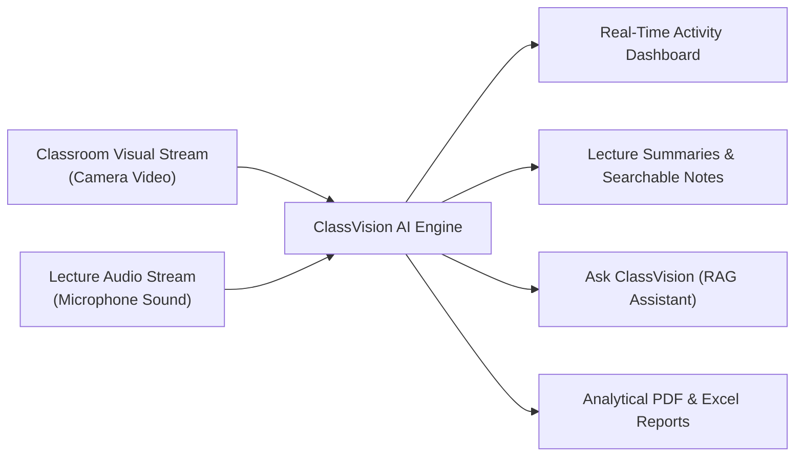
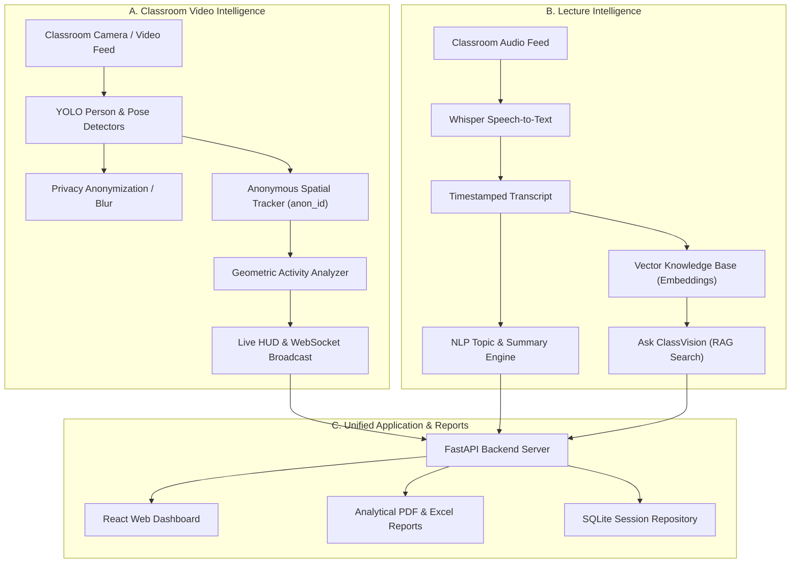
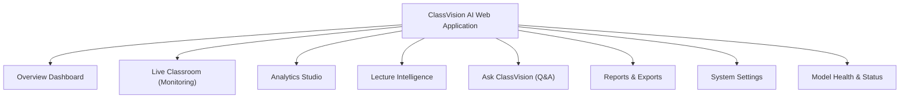
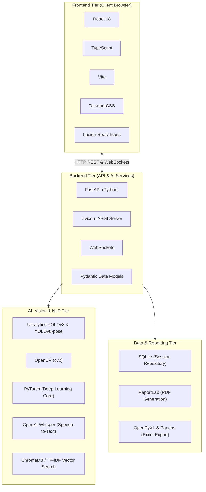
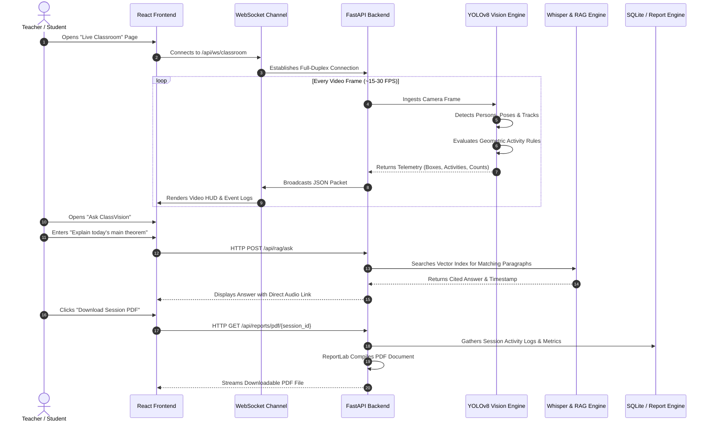

# ClassVision AI

### Real-Time Multimodal Classroom Intelligence System

> **ClassVision AI** is an intelligent, privacy-preserving classroom assistance system that brings together real-time **Computer Vision** and **Lecture Intelligence**. It helps educators understand physical classroom dynamics (such as student participation and observable activities) while simultaneously organizing lecture audio, generating structured study summaries, and enabling conversational question-answering over classroom materials.

---

## 1. Table of Contents

- [1. Table of Contents](#1-table-of-contents)
- [2. About the Project](#2-about-the-project)
- [3. Problem Statement](#3-problem-statement)
- [4. Project Objectives](#4-project-objectives)
- [5. How ClassVision AI Works](#5-how-classvision-ai-works)
  - [A. Classroom Video Intelligence Pipeline](#a-classroom-video-intelligence-pipeline)
  - [B. Lecture Intelligence Pipeline](#b-lecture-intelligence-pipeline)
  - [C. Unified Application and Analytics](#c-unified-application-and-analytics)
- [6. Major Features](#6-major-features)
- [7. Application Modules](#7-application-modules)
- [8. Technology Stack](#8-technology-stack)
- [9. System Architecture](#9-system-architecture)
- [10. Privacy and Responsible AI](#10-privacy-and-responsible-ai)
- [11. Project Applications](#11-project-applications)
- [12. What Makes ClassVision AI Different?](#12-what-makes-classvision-ai-different)
- [13. Current Development Status](#13-current-development-status)
- [14. Future Scope](#14-future-scope)
- [15. Project Information](#15-project-information)
- [16. Conclusion](#16-conclusion)

---

## 2. About the Project

In a modern educational institution, teachers face two major challenges:
1. **Physical Classroom Engagement:** It is difficult for an instructor standing in front of a lecture hall of 40 to 100 students to notice who is raising their hand in the back rows, how many students are actively seated and facing forward, or whether the overall room is engaged.
2. **Lecture Information Overload:** After class ends, students are left with hours of spoken audio and whiteboard notes, making revision time-consuming and search difficult.

**ClassVision AI** solves both problems simultaneously by building a single, multimodal platform.

### What Does "Multimodal" Mean?
*Multimodal AI* is an artificial intelligence system that can process and understand multiple types of information at the same time—in this project, **live video** (visual signals) and **spoken lecture audio / text** (linguistic signals).

By combining these two distinct channels of intelligence, ClassVision AI bridges the physical world of the lecture hall with the intellectual content of the lecture.

### Core Technologies Made Simple
- **Computer Vision (CV):** The field of computer science that teaches computers how to see, process, and extract meaningful information from digital video and images.
- **Object Detection:** An AI technique that locates items in an image and draws a rectangular box (a *bounding box*) around each detected object.
- **Human Pose Estimation:** An advanced vision method that detects key skeletal joints on a human body—such as the eyes, nose, shoulders, elbows, and wrists—allowing the computer to understand how a person is sitting or moving.
- **Activity Recognition:** The process of using detected body positions to classify physical actions, such as raising a hand, facing the board, or bowing the head to read.
- **Speech Recognition:** Technology that converts spoken human voice from a classroom microphone into written digital text (speech-to-text).
- **Natural Language Processing (NLP):** Software techniques that help computers read, interpret, summarize, and organize human written language.
- **Retrieval-Augmented Generation (RAG):** An intelligent search technique that takes a user's question, finds the exact relevant paragraphs from the lecture notes, and presents an accurate, factual answer without making things up.

---

## 3. Problem Statement

Traditional classroom monitoring and academic revision suffer from critical limitations:

1. **Teacher Tunnel Vision:** An instructor actively delivering complex course material cannot continuously scan all rows of an auditorium. Students sitting in the back or near corners who raise their hands often go unnoticed.
2. **Subjective Attendance and Manual Headcounts:** Taking attendance manually takes 5 to 10 minutes away from instructional time. Traditional paper roll calls or badge scanners only record that a student entered the doorway, not room presence or class participation.
3. **Loss of Spoken Knowledge:** Up to 70% of vital course context is communicated spoken aloud by the professor. When class ends, that spoken explanation is lost unless recorded and painstakingly re-listened to for hours.
4. **Lack of Objective Feedback:** When teachers want to improve their instructional pace, they have no objective data on when student participation spiked or dropped during a 60-minute session.
5. **Privacy and Surveillance Risks in Conventional Systems:** Many commercial school surveillance systems attempt facial recognition, student identity tracking, or unscientific "emotion / attention scoring" that can cause student stress and violate data privacy regulations.

ClassVision AI was designed from the ground up to address these challenges with **objective physical measurements** and **strict privacy protections**.

---

## 4. Project Objectives

The primary engineering goals of ClassVision AI are:

- **Automate Real-Time Classroom Observation:** Detect seated students, count room occupancy, and identify observable physical behaviors (hand raises, board orientation, head posture) without human intervention.
- **Preserve Absolute Student Privacy:** Guarantee that no biometric facial recognition, personal identity matching, or emotional surveillance is ever performed.
- **Enable Anonymous Session Tracking:** Assign temporary, randomized IDs (`anon_001`, `anon_002`) that exist only for the duration of a single session and leave no persistent identity trail.
- **Transcribe and Structure Spoken Lectures:** Turn classroom audio into clean, timestamped text transcripts organized by topics and key concepts.
- **Provide a Conversational Study Assistant:** Give students an interactive question-answering tool ("Ask ClassVision") that answers questions based exclusively on what the teacher explained in class.
- **Produce Standardized Academic Reports:** Generate automated PDF and Excel analytical reports for educators, department heads, and academic quality assurance committees.
- **Deliver a Fast, Interactive Web Interface:** Build a responsive, user-friendly frontend dashboard running smoothly on modern web browsers over real-time WebSockets.

---

## 5. How ClassVision AI Works

The system operates across two parallel intelligence engines coordinated by a central application server:

### A. Classroom Video Intelligence Pipeline

1. **Video Ingestion:** The system captures video frames from a live classroom webcam, IP camera, or recorded session video at standard classroom resolutions.
2. **Person Detection:** A fast deep-learning model (**YOLOv8n**) identifies each visible student in the frame and draws an accurate bounding box around them.
3. **Human Pose Estimation:** The vision pipeline (**YOLOv8n-pose**) locates 17 physical anatomical keypoints (such as wrists, elbows, shoulders, ears, and nose) for every detected student.
4. **Anonymous Tracking:** The **Temporal Tracker** assigns a randomized identifier (e.g., `anon_014`) to each person by calculating how their bounding box moves smoothly across consecutive frames. No personal identity or facial scan is ever saved.
5. **Geometric Activity Classification:** Instead of guessing internal thoughts or moods, the system applies clear mathematical rules to physical body joint positions:
   - *Hand Raised:* The wrist joint rises noticeably above the shoulder and eye levels.
   - *Facing Board:* The student is oriented forward toward the front teaching area.
   - *Head Bowed:* The nose joint dips downward relative to the shoulders (indicating reading, notebook writing, or desk-level work).
   - *Head Turned:* The head keypoints shift laterally beyond the shoulder midpoint (indicating looking sideways toward a peer).
   - *Phone Visible:* A secondary object detection pass searches for mobile devices near hands or desk surfaces.
6. **Privacy Anonymization:** If privacy mode is toggled ON, the software applies a real-time Gaussian blur over all detected student heads and faces before the video reaches the user interface.
7. **WebSocket Streaming:** The processed telemetry (coordinates, track numbers, activity flags, room counts) is compressed into lightweight JSON packets and broadcasted over WebSockets to the web browser in real time (sub-100 millisecond response).

### B. Lecture Intelligence Pipeline

1. **Audio Recording:** Spoken instruction from the instructor's microphone is captured in chunks.
2. **Speech Recognition:** The audio stream is processed through OpenAI's **Whisper** speech-to-text model, turning spoken sentences into formatted text marked with exact second-by-second timestamps.
3. **Text Summarization & Topic Extraction:** Natural Language Processing routines extract key lecture themes, important definitions, bulleted takeaways, and a clean executive overview of the class.
4. **Vector Database Ingestion:** The timestamped lecture transcript is split into small semantic paragraphs. Each paragraph is transformed into a mathematical concept vector (*text embedding*) and stored in a specialized search database.
5. **Retrieval-Augmented Generation (RAG):** When a student or teacher asks a question in "Ask ClassVision", the system finds the closest matching lecture segments and provides a direct, cited answer.

### C. Unified Application and Analytics

1. **Session Coordination:** The backend ties together the visual timeline (how many hands were raised at minute 24) with the audio timeline (what topic was being discussed at minute 24).
2. **Interactive UI:** The React frontend displays dynamic charts, real-time video overlays, searchable transcripts, and filter controls.
3. **Report Generation:** At the conclusion of a session, a single click produces comprehensive PDF summary documents and spreadsheet tables for archiving.

---

## 6. Major Features

| Feature Name | What It Does | Why It Is Useful |
| :--- | :--- | :--- |
| **Real-Time Student Detection** | Identifies students seated across multiple rows, even when partially occluded by desks and computer monitors. | Gives an immediate, objective count of students present in the classroom without taking away lecture time for roll calls. |
| **Skeletal Pose Estimation** | Accurately maps 17 key body joints (wrists, elbows, shoulders, neck, head) for every detected person. | Understands physical posture directly from body geometry rather than guessing from vague silhouettes. |
| **Anonymous Session Tracking** | Tracks individual student positions over time using temporary session labels (`anon_001`, `anon_002`). | Measures how long a student participated without storing names, student IDs, or biometrics. |
| **Observable Activity Recognition** | Classifies concrete physical behaviors: *Hand Raised*, *Facing Board*, *Head Bowed*, and *Head Turned*. | Helps the instructor know when questions arise and provides objective data on student engagement. |
| **Live Privacy Blur** | Dynamically blurs facial and body areas in the live video stream on demand. | Enables open viewing and demonstration in administrative settings while respecting student privacy rights. |
| **Speech-to-Text Transcription** | Converts spoken classroom instruction into a clean, searchable transcript with exact timestamps. | Allows students to quickly review complex sections of a lecture without scrubbing through hours of video. |
| **Automated Lecture Summarization** | Automatically produces bullet-point summaries, main topic overviews, and key takeaways from the lecture text. | Saves hours of study time and helps students revise quickly before exams. |
| **Smart Topic Extraction** | Scans lecture text to identify primary academic topics, technical terminology, and subject keywords. | Automatically builds an index of concepts covered across the entire semester. |
| **Ask ClassVision (RAG Search)** | An interactive Q&A assistant that answers questions using only what was stated in the lecture. | Acts as a 24/7 personalized teaching assistant that never invents answers outside the teacher's lecture notes. |
| **Comprehensive Analytics Dashboard** | Displays timeline graphs of hand-raising frequency, room presence, and activity distribution across rows. | Gives teachers and department administrators deep pedagogical feedback on lecture engagement. |
| **Automated PDF & Excel Reports** | Generates publication-ready PDF analytical reports and structured Excel (`.xlsx`) spreadsheets with one click. | Provides physical documentation for departmental audits, accreditation records, and academic reviews. |

---

## 7. Application Modules

The frontend interface of ClassVision AI is divided into specialized modules accessible from a clean navigation sidebar:

### 1. Overview Dashboard (`/dashboard`)
The mission control center for the application. It summarizes high-level metrics across the academic department: total active sessions, today's average student count, aggregate hand-raise activity, and quick-launch shortcuts for starting new sessions.

### 2. Live Classroom (`/monitoring`)
The real-time operational window for in-session video intelligence:
- Displays the live video feed (webcam or uploaded classroom video).
- Draws the real-time AI Heads-Up Display (HUD): colored bounding boxes, joint skeleton overlays, and anonymous track labels (`anon_xxx`).
- Provides quick interactive toggles: **Person Box Mode**, **Pose Skeleton Mode**, and **Privacy Blur**.
- Features an instant filtering bar: isolates specific students (e.g., viewing only *Hand Raised (2)* or *Needs Review*).
- Shows a real-time event log recording each detected activity timestamp.

### 3. Analytics Studio (`/analytics`)
A deep-dive data exploration page designed for post-lecture analysis:
- **Participation Timeline:** Line graphs showing the rise and fall of student participation minute-by-minute.
- **Activity Breakdown:** Donut charts illustrating the proportion of time spent facing the board, taking notes (head bowed), or raising hands.
- **Multi-Row Analysis:** Compares front-row vs. back-row engagement to identify whether rear students are disengaged.

### 4. Lecture Intelligence (`/intelligence`)
The knowledge center for spoken course content:
- Features an interactive transcript reader where users can jump to any second of the lecture by clicking on a sentence.
- Displays automatically generated executive summaries and core concept cards.
- Lists extracted subject tags and technical vocabulary highlighted during class.

### 5. Ask ClassVision (`/ask`)
An intelligent conversational study interface:
- Students type natural-language questions (e.g., *"What explanation did the professor give for Newton's third law during the demo?"*).
- The Retrieval-Augmented Generation (RAG) backend searches the lecture database, retrieves the exact passage spoken, and generates a clear, factual answer with timestamp citations.

### 6. Reports & Exports (`/reports`)
The administrative documentation hub:
- Previews session analytics before exporting.
- Offers instant downloads of **Professional PDF Reports** (including header branding, attendance tables, activity distributions, and lecture summaries).
- Generates **Excel Data Sheets (`.xlsx`)** for statistical archiving and institutional database import.

### 7. System Settings (`/settings`)
System-level controls and tuning:
- Adjusts detection confidence thresholds and NMS overlap parameters.
- Selects video input sources (DirectShow USB Webcams, RTSP IP cameras, or prerecorded demo video files).
- Configures camera orientation presets (Front View, Rear View, Side Angle).
- Enforces strict privacy defaults and data storage directories.

### 8. Model Health & Status (`/models`)
A diagnostic monitoring screen that confirms the status, memory usage, and initialization health of every backend deep learning checkpoint (YOLOv8n, YOLOv8n-pose, Whisper, OCR, and Vector Embeddings).

---

## 8. Technology Stack

ClassVision AI is built using modern, production-grade open-source tools:

### Detailed Component Roles

- **Frontend:**
  - **React 18:** Component-based user interface framework providing reactive page updates.
  - **TypeScript:** Adds static type safety, preventing common JavaScript runtime bugs across complex telemetry streams.
  - **Vite:** Next-generation frontend build tool and development server providing instant hot-module replacement.
  - **Tailwind CSS:** Utility-first CSS framework delivering a clean, modern aesthetic with consistent color palettes.
  - **Lucide Icons:** Clean, accessible vector icons for clear visual navigation.

- **Backend:**
  - **FastAPI:** High-performance asynchronous Python web framework used for high-speed REST endpoints and WebSocket channels.
  - **Uvicorn:** Production-ready ASGI web server powering concurrent request handling.
  - **WebSockets:** Full-duplex communication protocol enabling live video telemetry streaming without HTTP polling lag.
  - **Pydantic:** Robust data validation library that validates incoming camera configurations and telemetry payloads.

- **Computer Vision & Deep Learning:**
  - **Ultralytics YOLOv8n:** Lightweight real-time object detection model locating human students at high frame rates.
  - **Ultralytics YOLOv8n-pose:** Specialized keypoint estimation network predicting 17 human skeletal joints.
  - **OpenCV (`cv2`):** Fundamental computer vision library handling camera capture, color space conversions, image resizing, and Gaussian blur rendering.
  - **PyTorch:** The underlying deep learning tensor framework running neural network forward passes.

- **Speech, NLP & Vector Retrieval:**
  - **OpenAI Whisper:** State-of-the-art automatic speech recognition engine converting audio into punctuated, timestamped text.
  - **ChromaDB / Semantic Retrieval:** High-speed vector database that matches user queries to corresponding lecture transcript segments.

- **Database & Reporting:**
  - **SQLite:** Lightweight, serverless relational database that stores session metadata, activity logs, and aggregate metrics without requiring complex database server setup.
  - **ReportLab:** Python PDF generation toolkit that builds cleanly styled academic PDF reports.
  - **OpenPyXL & Pandas:** Data manipulation and spreadsheet libraries exporting structured Excel datasets.

---

## 9. System Architecture

The software architecture separates high-speed frame processing from heavy natural language processing to ensure that the user interface never freezes:

---

## 10. Privacy and Responsible AI

ClassVision AI was engineered from the very first commit under a strict **Ethical and Responsible AI** philosophy:

1. **NO Facial Recognition:** The system does not scan, extract, or store facial embeddings, facial landmarks, or biometric identities. It has zero capability to identify who a student is.
2. **NO Persistent Identity Profiles:** Bounding boxes receive arbitrary, short-lived session tags (`anon_001`, `anon_002`) that reset when the camera session ends. No student tracking profiles are maintained across days or courses.
3. **NO Pseudoscientific Attention or Emotion Detection:** ClassVision AI rejects claims that artificial intelligence can measure internal human feelings, attention levels, or boredom from facial micro-expressions. The system strictly logs **observable physical facts** (e.g., *Wrist position elevated above shoulder line = Hand Raised*), leaving pedagogical interpretation to human educators.
4. **On-Demand Privacy Blurring:** The system includes a built-in Gaussian blur engine. When enabled, all student faces and personal features are obscured directly at the video pipeline level before any frame reaches the screen.
5. **Strict Local Storage Policies:** Real classroom video files and identifiable student media are deliberately excluded from cloud-synchronized directories (such as OneDrive or public repositories) to prevent accidental data leaks.

---

## 11. Project Applications

ClassVision AI is designed for immediate value across multiple educational settings:

- **Higher Education Lecture Auditoriums:** In university lecture halls seating 100+ students, instructors can quickly notice hand-raising in distant rows, ensuring every student has a voice.
- **Hybrid & Remote Learning Environments:** Online remote students and physical in-person attendees can be observed in a unified dashboard, giving the teacher a balanced view of class participation.
- **Teacher Self-Reflection & Pedagogical Improvement:** Instructors can review post-session timelines to see which explanations provoked questions and which segments experienced quiet note-taking.
- **Accessible Student Study Support:** Students who are hearing-impaired, non-native language speakers, or absent due to illness can read timestamped transcripts, examine summaries, and ask the conversational assistant questions about the missed lecture.
- **Academic Administration & Accreditation Documentation:** Universities require proof of student engagement and continuous course quality improvement. The automated PDF and Excel reporting suite provides instant, verifiable records for accreditation bodies.

---

## 12. What Makes ClassVision AI Different?

| Feature | Standard Security Cameras | Commercial "Attention AI" Apps | ClassVision AI |
| :--- | :--- | :--- | :--- |
| **Primary Focus** | Security surveillance and property monitoring. | Intrusive emotion tracking and individual grading. | **Educational assistance and lecture understanding.** |
| **Biometric Privacy** | Often records faces without anonymization. | Analyzes personal facial features and stores identities. | **Zero facial recognition; anonymous session tracking (`anon_xxx`).** |
| **Activity Interpretation** | None (passive recording only). | Unscientific "attention / emotion scores". | **Objective, geometry-based physical activity labels.** |
| **Lecture Content Analysis** | Completely blind to lecture audio and topics. | None (vision only). | **Integrated speech-to-text, summarization, and RAG Q&A.** |
| **Student Privacy Controls** | None. | Rare. | **Real-time privacy blur and local data storage isolation.** |
| **Academic Reporting** | Raw video footage only. | Proprietary compliance scores. | **Automated publication-ready PDF and Excel analytical reports.** |

---

## 13. Current Development Status

To maintain transparent engineering documentation, this table outlines what is fully working, what is partially integrated, and what is slated for upcoming development phases:

| Module / Feature | Status | Description |
| :--- | :---: | :--- |
| **Person Detection (YOLOv8n)** | `COMPLETED` | Real-time seated student detection operating at high frame rates on standard hardware. |
| **Human Pose Estimation (YOLOv8n-pose)** | `COMPLETED` | 17-point skeletal landmark detection running concurrently on CPU and GPU. |
| **Anonymous Temporal Tracking** | `COMPLETED` | Bounding-box IoU and spatial tracking assigning temporary `anon_xxx` labels across video frames. |
| **Geometric Activity Classification** | `COMPLETED` | Deterministic vector rules classifying *Hand Raised*, *Facing Board*, *Head Bowed*, and *Head Turned*. |
| **Real-Time Privacy Blur** | `COMPLETED` | Instant Gaussian blurring of detected heads/faces togglable via UI or API. |
| **WebSocket Streaming Pipeline** | `COMPLETED` | Sub-100ms full-duplex telemetry streaming between FastAPI backend and React frontend. |
| **Speech Transcription (Whisper)** | `COMPLETED` | Audio speech-to-text transcription engine producing timestamped sentence arrays. |
| **Automated Summarization & Topics** | `COMPLETED` | NLP service creating bullet-point lecture summaries and extracting subject keywords. |
| **Ask ClassVision (RAG Assistant)** | `COMPLETED` | Question-answering pipeline using semantic vector retrieval over lecture transcripts. |
| **PDF & Excel Report Generator** | `COMPLETED` | Automated generation of styled PDF analytical reports and structured `.xlsx` spreadsheets. |
| **Interactive Web Application** | `COMPLETED` | Complete React + Vite + Tailwind interface covering Dashboard, Live Monitoring, Analytics, Intelligence, Reports, and Settings. |
| **Mobile Phone Detection** | `PARTIALLY IMPLEMENTED` | Secondary detection pass exists; fine-tuning on modern handheld phone datasets in progress to handle edge-case postures. |
| **Whiteboard OCR Recognition** | `PARTIALLY IMPLEMENTED` | Base OCR endpoints and character recognition pipelines exist; full board text tracking is in validation. |
| **Specialized Rear-View Classroom Weights** | `PLANNED` | Fine-tuning YOLO on visible-body crowded student datasets (e.g., CrowdHuman `vbox`) to resolve heavily occluded back rows. |
| **Multi-Camera Hall Fusion** | `PLANNED` | Combining multiple camera angles (front-facing and rear-facing) into a single 3D room coordinate space. |

---

## 14. Future Scope

The foundational architecture of ClassVision AI allows for several exciting long-term enhancements:

1. **Multi-Camera Fusion:** Connecting both a front-facing camera (viewing students) and a rear-facing camera (viewing the instructor and whiteboard) to create a synchronized 360-degree digital twin of the lecture hall.
2. **Edge Hardware Deployment:** Optimizing neural network models via ONNX Runtime and TensorRT to run smoothly on energy-efficient edge devices such as the NVIDIA Jetson Orin Nano, enabling standalone classroom smart boxes.
3. **Automated Blackboard Equation Digitization:** Expanding whiteboard OCR into mathematical LaTeX formatting so that formulas written by hand on a chalkboard automatically convert into digital textbook notes.
4. **Learning Management System (LMS) Integration:** Building automated connectors to platforms like Canvas, Moodle, and Google Classroom to post lecture summaries and participation summaries directly into course portals.
5. **Acoustic Question Localization:** Pairing visual hand-raise detection with directional microphone arrays to automatically focus audio capture on the specific student asking a question.

---

## 15. Project Information

- **Project Name:** ClassVision AI
- **Full Project Title:** Real-Time Multimodal Classroom Intelligence System
- **Academic Domain:** Artificial Intelligence, Computer Vision, Speech Processing, Natural Language Processing
- **Target Audience:** Universities, Colleges, High Schools, Educational Researchers, and Smart Campus Administrators
- **Core Technologies:** Python, FastAPI, React, TypeScript, YOLOv8, PyTorch, Whisper, SQLite, ReportLab
- **Application Type:** Full-Stack Multimodal Web Application with Real-Time Video Telemetry
- **Primary Mission:** To assist teachers, empower students, and understand classroom dynamics while strictly protecting personal privacy.

---

## 16. Conclusion

**ClassVision AI** proves that artificial intelligence in education does not need to compromise personal privacy or make unverified psychological claims to be genuinely useful.

By focusing on **objective computer vision metrics** (such as visible hand-raises, seating counts, and body orientation) and unifying them with **practical lecture intelligence** (such as automated speech transcription, conceptual summaries, and semantic study search), ClassVision AI transforms the everyday classroom into an intelligent, accessible, and supportive learning environment. It honors the teacher's craft, respects student dignity, and ensures that no valuable insight from a lecture is ever lost.

---

## 17. Final Project Tagline

> ### *"See the Classroom. Understand the Activity. Learn from Every Lecture."*

---
*ClassVision AI — Developed as an advanced multimodal academic research project.*
